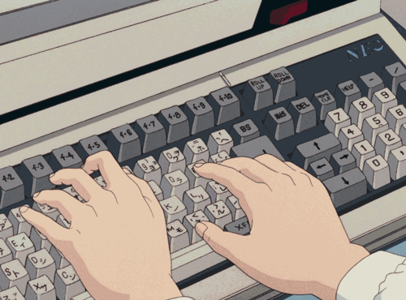
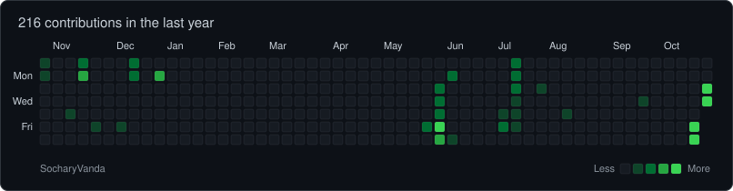
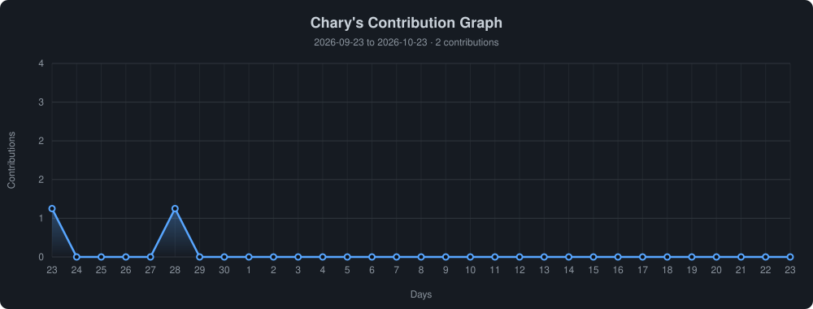

<!-- 

  

 -->

  

Building projects, breaking things, and learning how it all fits together.

---

<h2 align="left"></h2>

**Chary** here — a Computer Science student from Phnom Penh, Cambodia.

I like turning ideas into working code, from small programs in **C, C++ and Java** to **Python** scripts and websites built with **HTML, CSS and JavaScript**.

Right now I'm focused on strengthening my fundamentals and building projects that teach me something new each time.

My goal is simple: keep learning, write clean code, and grow into a software engineer who builds things people actually use.

 

<h2 align="left"></h2>

  &nbsp;
  &nbsp;
  

<h2 align="left"></h2>

  

<h2 align="left"></h2>

  
  &nbsp;
  

<h2 align="left"></h2>

  

<h2 align="left"></h2>

  

<h2 align="left"></h2>

  <picture>
    <source media="(prefers-color-scheme: dark)" srcset="https://raw.githubusercontent.com/SocharyVanda/SocharyVanda/output/github-snake-dark.svg" />
    <source media="(prefers-color-scheme: light)" srcset="https://raw.githubusercontent.com/SocharyVanda/SocharyVanda/output/github-snake.svg" />
    
  </picture>

---

